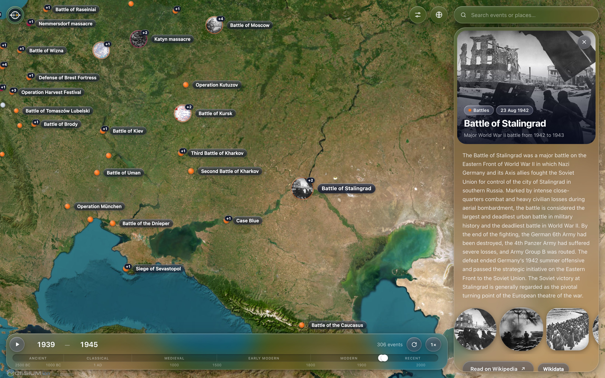
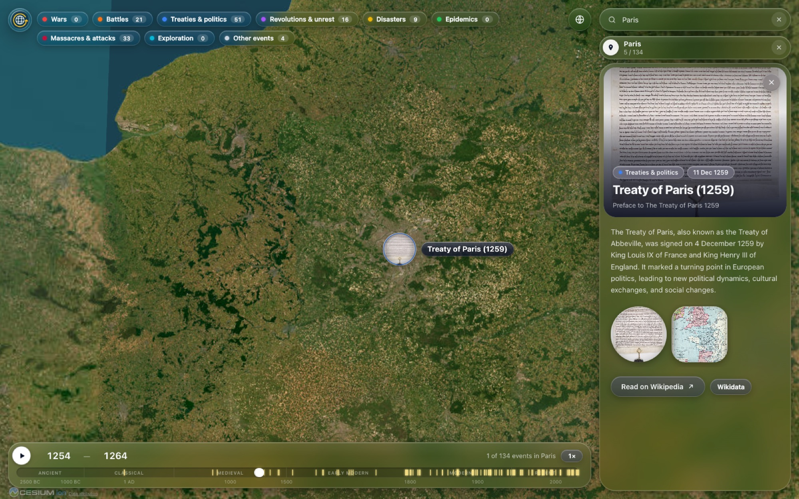

# Chronoglobe



A 3D globe (CesiumJS) with a timeline. Historical events with an English
Wikipedia article appear at the places they happened. Notable events ship with
the site; more detail comes live from Wikidata SPARQL as you zoom in. Summaries and photos come from the Wikipedia REST API.

```bash
npm install
npm run dev        # http://localhost:5173
npm run build      # production build in dist/
```

Optional: copy `.env.example` to `.env` and set `VITE_CESIUM_ION_TOKEN` (free at
ion.cesium.com) to get Cesium World Imagery + 3D terrain. Without a token, Esri
World Imagery is used.

## Features
- Satellite globe with clustered markers. The most notable events show as glass photo
  bubbles with their names on the map.
- Timeline from 3000 BCE to today: drag the window, type years (`480 BC`, `1944`), or press play.
- Global search (press `/`) for any dated, mappable event. Picking one sets a 10-year
  window around it and flies there.
- **Places:** search a city, region or country (Paris, Kyoto, Normandy, France) to see every
  event that happened there across all of history. The timeline ticks each one, and **Play**
  tours them in date order, opening each event's photos and summary. Press ✕ or Esc to leave.
- Event pop-up with the Wikipedia summary, a lead photo and an article photo gallery.
- Side panel that brings each period to life: an auto-cycling **Spotlight** of its headline
  events (photo, date, the opening of the article), a category mix bar, **Hidden gems**
  (lesser-known events with photos, reshuffleable), and the full list sorted by notability
  or as a timeline. Hovering any of them highlights the event on the globe.
- **Load more here** (the ↻ bubble on the timeline): loads every event in the visible map area
  for the current time range, not just the period's globally notable ones.
- Hover the logo: it stretches into a pill with the name, then an About panel drops down: how to use it, your (guest) account and cache, and
  technical details (versions, data sources, what's loaded).
- Category filters tucked into a glass bubble beside the globe button, a Liquid Glass UI,
  and a phone layout with a bottom sheet.



## How it works
Loading is tiered, so events show within a fraction of a second:
1. **Seed:** `public/data/seed-events.json` (~110 KB gzipped) holds the ~4,300 most
   notable events across all eras. It loads with the page. Rebuild it with `npm run seed`.
2. **Detail:** when you zoom in on the map or narrow the timeline to 30 years or less,
   live Wikidata queries add the rest of the period's events in the background.
3. **Caching:** Wikidata responses are kept in the browser's Cache Storage for 7 days.
   Cesium (~4 MB) loads in its own chunk, so the interface appears before the globe.

- `src/lib/wikidata.ts`: SPARQL over a fixed list of event classes (battles, wars,
  treaties, disasters…), with a date + coordinates + enwiki article.
- `src/hooks/useEvents.ts`: splits the timeline range into aligned buckets, which are
  cached, fetched 3 at a time, retried once, and prefetched ahead while playing.
- `src/components/Globe.tsx`: markers placed so nothing overlaps. On each camera move,
  events are placed in priority order (selected, photo bubbles, then notability) with
  their name if it fits, as a bare marker if not, or hidden and counted as "+N" on the
  marker covering them. The most notable events show as photo bubbles.
- `src/lib/markerArt.ts`: canvas art for markers (glass dots, photo bubbles, glass name
  pills), drawn at 2–3× and handed to Cesium as data URLs so textures are reused.
- `src/lib/search.ts`: global search. Wikipedia full-text search, then one Wikidata
  lookup for each hit's date and place. Pages with coordinates but no event date are places.
- `src/lib/area.ts`: "Load more here". The period query plus a latitude/longitude filter for
  the visible area (~3 s per slice).
- `src/lib/places.ts`: events at a place, in three tiers: nearby seed events (instant),
  Wikidata's search index for events with their own coordinates nearby (~0.3 s), then a
  SPARQL query for events located in the place or up to two levels inside it, or anywhere in
  a country (a few seconds).
- `src/components/EventPanel.tsx`: hero image, summary, article photo gallery + lightbox.
- `src/styles.css`: Liquid Glass styling (backdrop blur/saturate, specular edges, bubbles).
